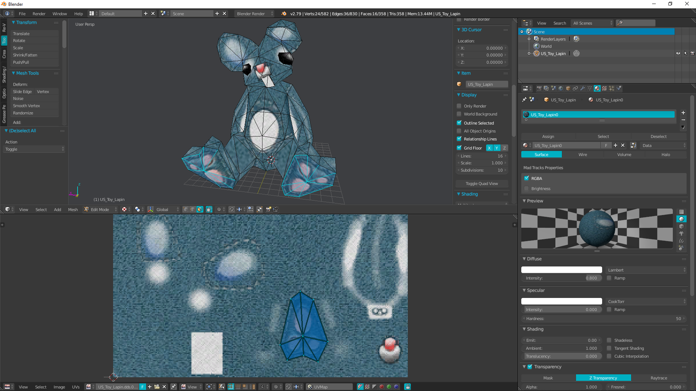
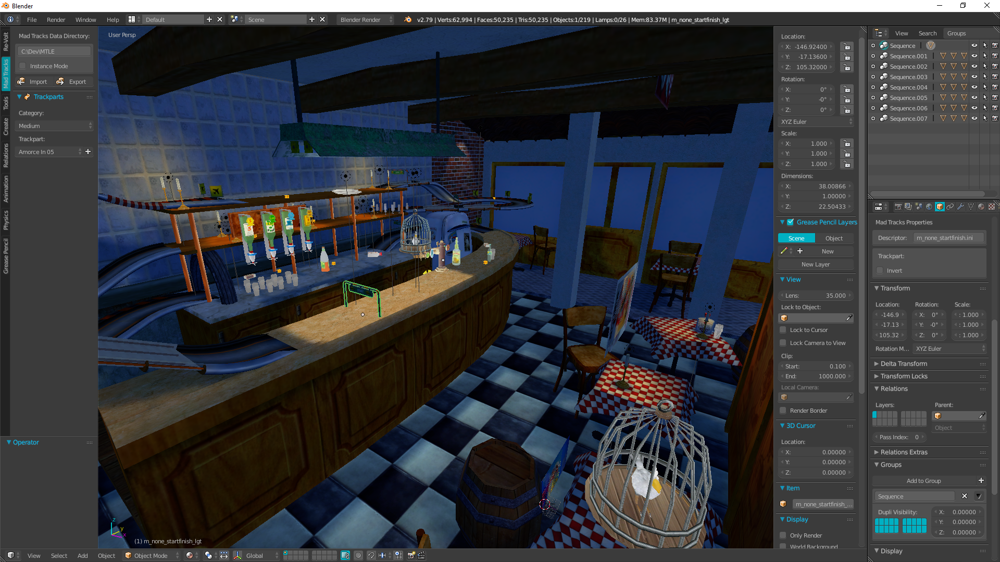
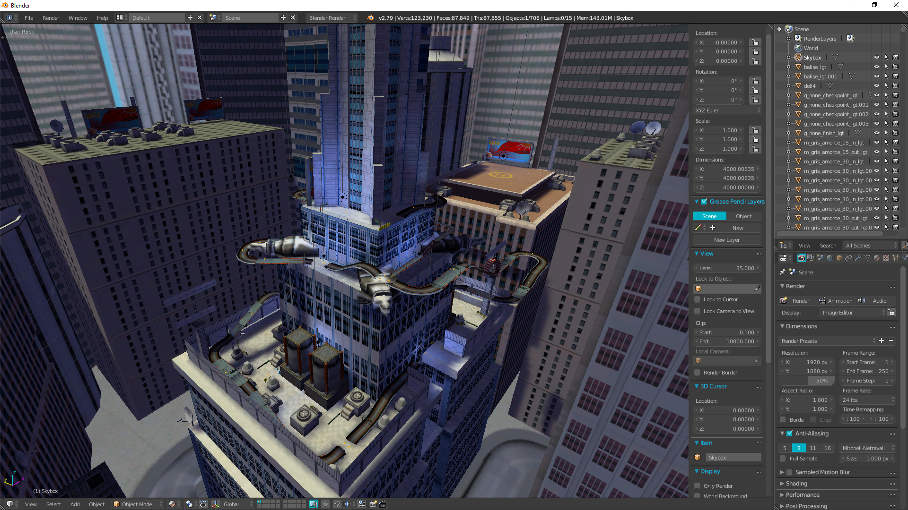

# Mad Tracks Blender 2.79b Add-on

Since Mad Tracks has been released on Steam, the game files are located in a data.zip file, easy to access and modify.  
The goal of this project is to import, edit and export them using Blender.

## Requirements

* Mad Tracks version Steam 2020 (older versions not supported)
* Blender version 2.79b (Windows and Linux, macOS not tested)

## Features

* Import game models with materials (collision models not supported)
* Import game objects (movable props, lights, force fields, game areas, ...)
* Export light objects
* Import/export levels with object instances, AI paths, intro/outro cameras, lightmap

Level editor:
* Edit trackpart sequences
* Edit AI paths
* Generate lightmaps (experimental)

## Setting up

1) Paste the `io_madtracks` folder in Blender's add-ons folder (`<blender_path>/scripts/addons`)
2) Open Blender, go to "File > User Preferences > Add-ons" and check "Import-Export: Mad Tracks"
3) A new tab in the left panel of the 3D view called "Mad Tracks" appeared
4) Extract `<madtracks_path>/Data/data.zip` to a new work folder (anywhere except in the game folder)
5) Paste the path of the work folder in the "Work Directory" field at the top of the "Mad Tracks" Blender panel

For convenience, go to "File > User Preferences > Input" to set the selection mouse button to "Left" and go to "Interface" tab to make sure "Cursor Depth" is enabled. Click on "Save User Settings".  
Also for convenience, remove the default Blender objects from the scene and go to "File > Save Startup File" to also save the pasted work folder path.

Read the [add-on guide](docs/ADDON_GUIDE.md) to get started!

## License

This project is licensed under the GNU GPLv3 License - see the LICENSE file for details

## Acknowledgments

Huge thanks to Marvin Thiel, the author of the [revolt-addon](https://gitlab.com/re-volt/re-volt-addon) who made this project possible.

