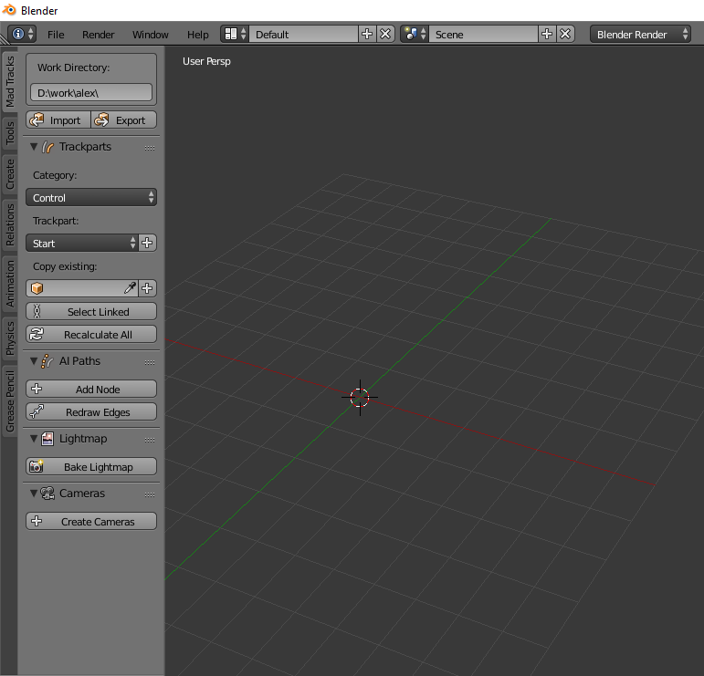
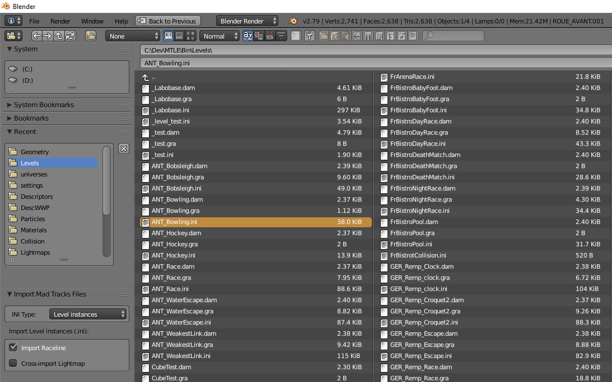
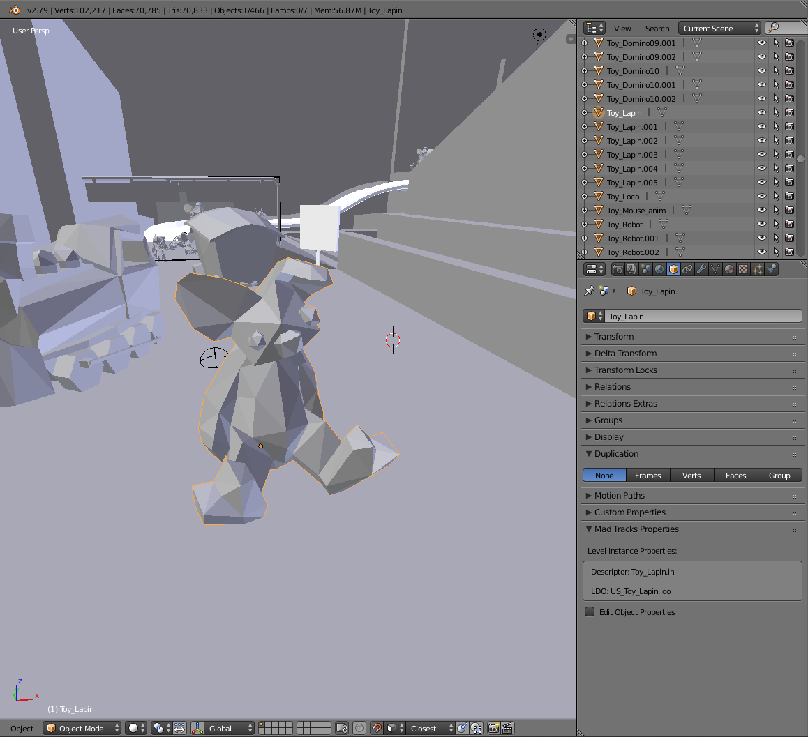
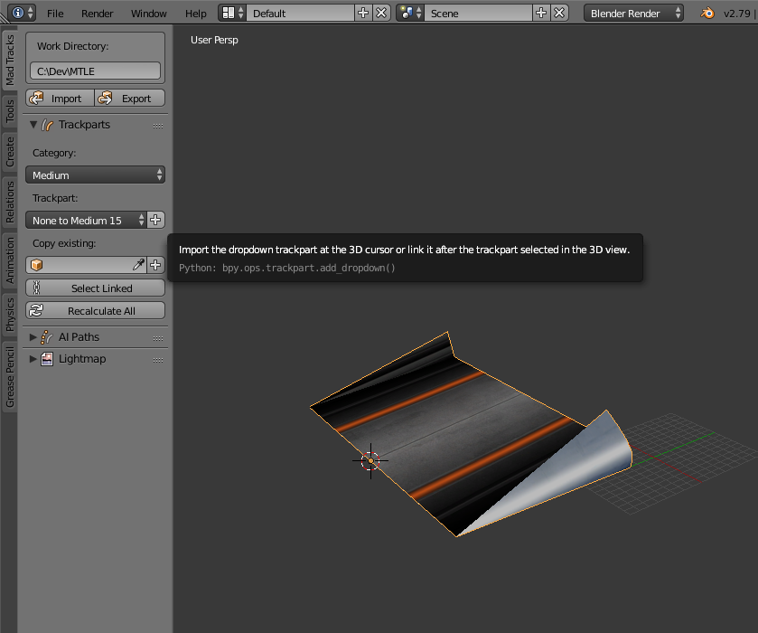
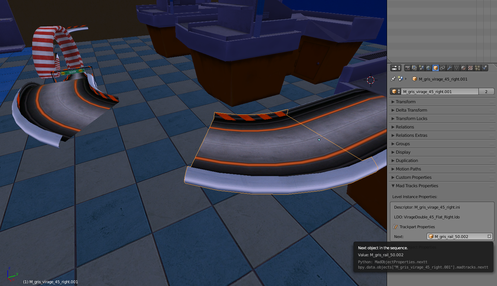
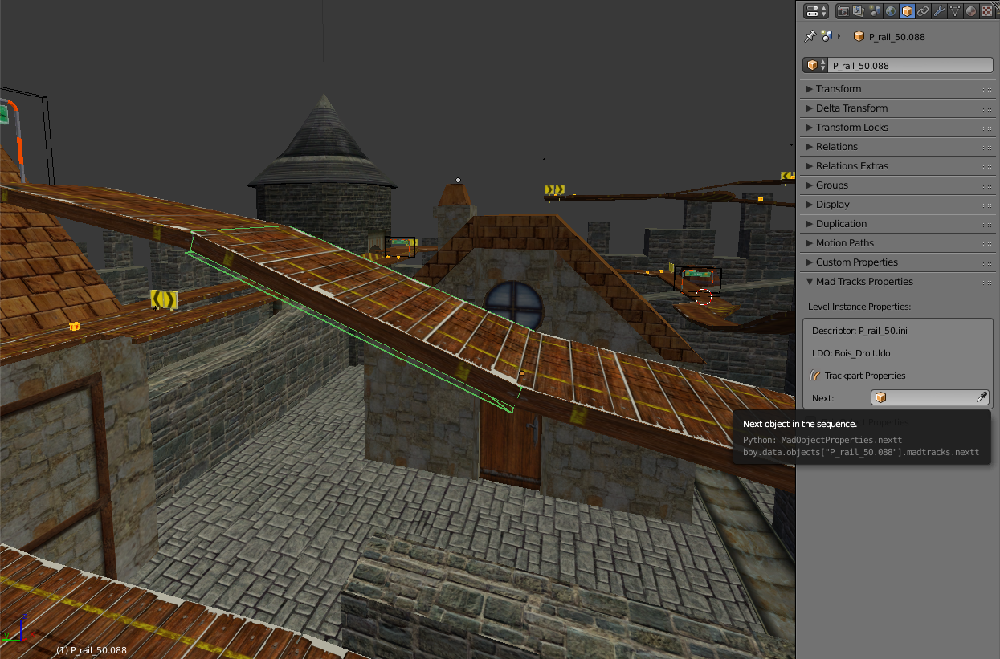
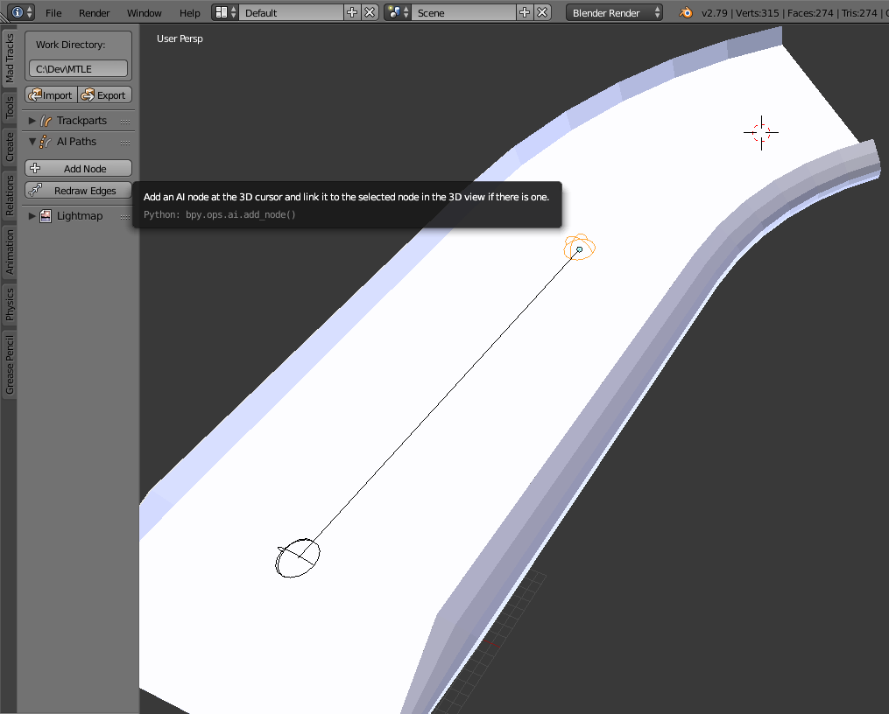
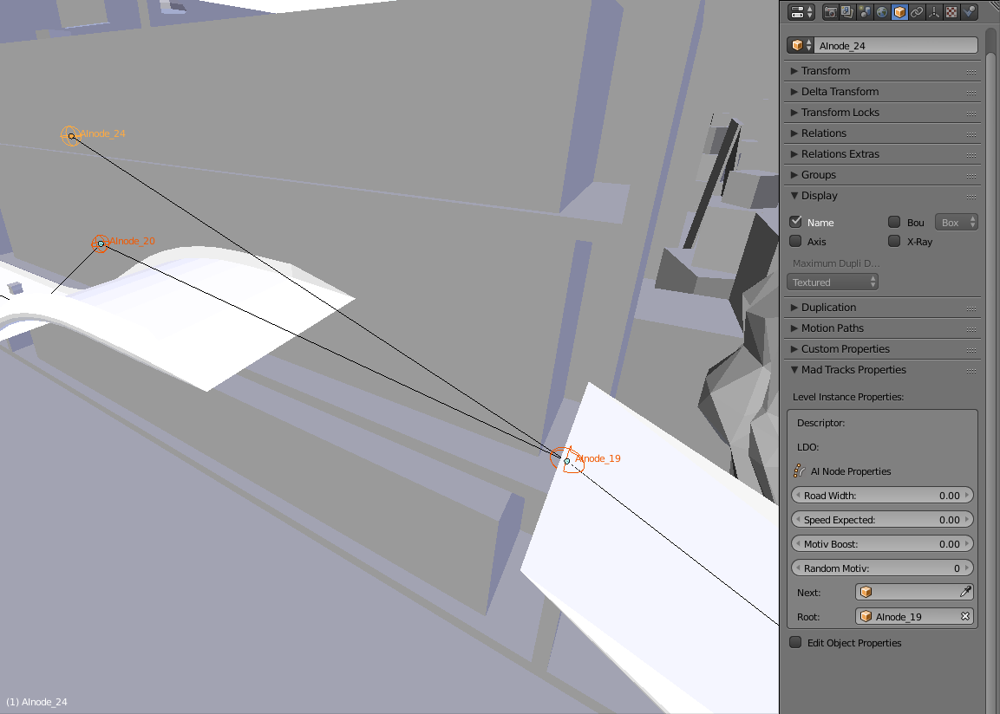
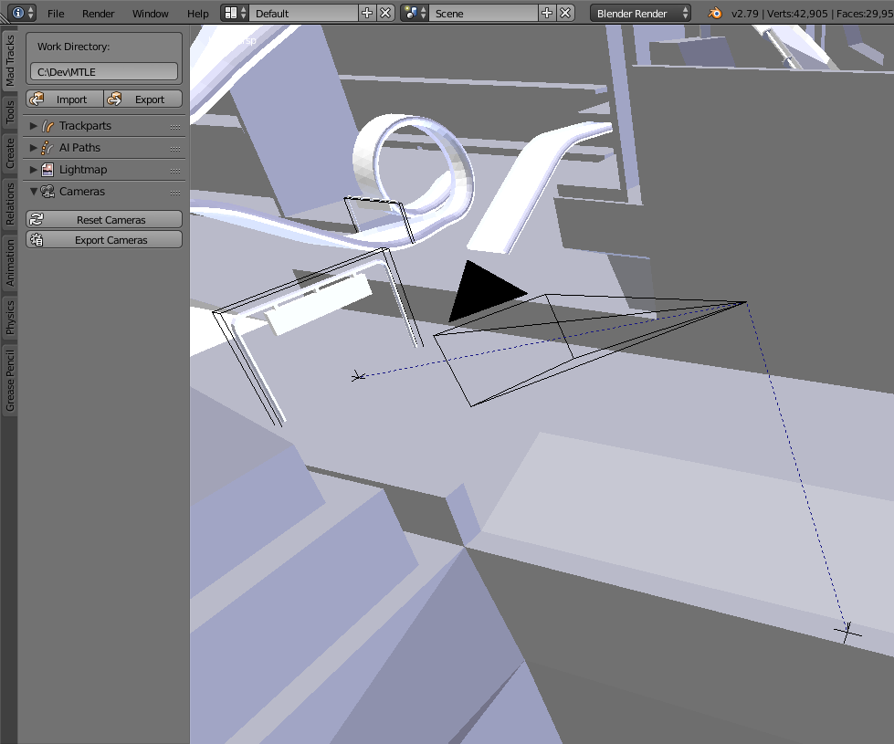
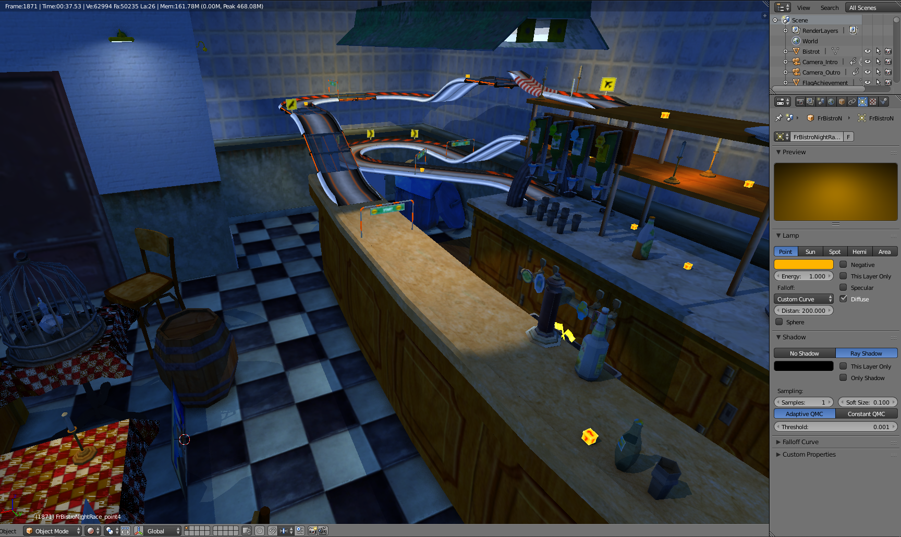

## Blender controls

Quick list of the most used key combinations when using the add-on for those unfamiliar with Blender (there will be a learning curve).  
All of these controls should be used in Object mode. Moving or rotating a mesh in Edit mode won't be picked up by the level exporter.
 
Move objects => `G + X/Y/Z (+ X/Y/Z for local axis)`, you can enter a distance with the numpad or use the mouse  

Rotate objects => `R + X/Y/Z (+ X/Y/Z for local axis)`, you can enter an angle with the numpad or use the mouse  

Duplicate objects => `Alt+D`, preferred over `Shift+D`  

Reset 3D view on selected objects => `Numpad .`  

Snap 3D cursor to selected objects and vice-versa (useful before importing assets) => `Shift+S`  

## Main panel

The main panel is accessible on the left of the 3D view in Object mode (hidden in Edit mode). All add-on features are here. From top to bottom:  
* **Work folder path**, needed to automatically import other necessary game files (like importing texture files if a model is imported).  
* **Import/Export** buttons will open the file browser to import/export game files.  
* **Trackparts subpanel** buttons will create and help to organize trackpart sequences in a way the game can understand.  
* **AI Paths subpanel** buttons will create and help to organize AI paths in a way the game can understand.  
* **Lightmap subpanel** buttons will *destructively* setup the scene for lightmap baking and allow to (re)generate a lightmap texture applied to the scene for preview.
* **Cameras subpanel** buttons will create level intro/outro cameras with movement constraints allowing to edit and preview the in-game result.

## Importing game assets

When clicking on the "Import" button of the main panel, the file explorer opens to let you pick a file from the work folder (working outside of this folder is possible but not recommended).  
When a file is selected, the file type and import options are displayed at the bottom of the left side bar.  
A list of supported file types (some partially supported):  
* `.ldo (...\Gfx\models\Geometry)`  
A static game 3D model with materials  
* `.ini (...\Bin\Descriptors)`  
A game object descriptor, it can define a movable model, a light, a camera, a pickup, a game area...  
* `.ini (...\Bin\Levels)`  
A list of static model and game object instances with positions and rotations that make a level  
* `.dam (...\Bin\Levels)`  
Level settings for game rules, the world to use, intro/outro cameras and more  
* `.gra (...\Bin\Levels)`  
A sequence of nodes and edges for AI navigation in a level  
* `.ldl (...\Gfx\Lightmaps)`  
A sequence of static models with UV coordinates of a level lightmap

If a `.ini` file is selected, the specific INI type needs to be set correctly in the options.

#### Tips

* When importing a level, importing the `.ini` file will give you most of the level geometry, but it's sometimes necessary to also import the `.dam` file since the optional level skybox and world geometry are defined there. Some levels are located at the bottom of the skybox, far below the 3D view origin.

* The add-on has trouble importing multiple levels correctly in the same Blender session. It's better to open a new session instead of deleting the previous level from the scene.

## Making a level

The add-on can be used to import, edit or create a level from scratch. A lot of effort was put in simplifying and automating the level editing process, but you will still need perseverance to finish your first fully-playable level, especially if you are new to Blender.  
After reading this chapter, I encourage you to import original levels and play with them before diving into your own level.

**Save your project regularly** as Blender can crash when updating the add-on custom properties and links.  
Keep your mouse on any UI button or field to get tooltips.

### 1) Placing level instances

Level instances are game assets imported and placed in the scene to make a level. They are exported in the level's `.ini` file with their individual position and rotation.  
Level instances can either be `.ldo` files or `.ini` descriptors.

Taking the tumbling toy bunny as an example, you can import the `US_Toy_Lapin.ldo` file for the model only, or import the `Toy_Lapin.ini` descriptor for the model and the tumbling physics. ("Lapin" means "Rabbit", editing levels will definitely expand your French vocabulary).  
You can select an instance and go to the Object Properties window to check if it was imported as a static model or as a descriptor. When looking at the bottom right corner of this picture, the name of the descriptor is present, so this bunny will have physics.

In a level editing context, trackparts (starts, checkpoints, finishes, road pieces) are level instances that shouldn't be imported directly. They must be handled with the trackparts editor (see next chapter).

#### Tips

* Importing an existing level .ini file is the recommended way to start making a level, since some of the environments are actually made of level instances. But there will be lots of level-specific instances to delete, even after disabling the "Import Raceline" option to skip trackparts and collectibles. After importing, hit *Space* and type "Select Pattern" to select all instances of a game asset by typing part of its name between wildcard (\*) characters.

* When importing a level instance, make sure the "As Level Instance" import option is checked. This imports an asset in a simplified and reusable way, suited for level editing.

* Instances are imported in the scene at the 3D cursor position. You can right click on a surface in the 3D view to set the cursor position there, thanks to the "Cursor Depth" option enabled when setting up the add-on. Else press *Numpad .* after importing to focus on the asset and place it manually.

* When rotating an instance, hit the *X*, *Y* or *Z* key a second time to rotate on the local axis. This is sometimes much easier than rotating on the global axis.

* When moving an instance, hit the *X*, *Y* or *Z* key a second time to translate on the local axis. This is sometimes much easier when the instance has been rotated. Blender gizmos are enabled by default and are fine for simple adjustments, but most of the time it will be quicker to disable them and use the magnet tool instead, which will snap the instance to surfaces of other instances when moving it. Look at the bottom toolbar of the picture above for reference.

* When duplicating an instance, using *Alt+D* is better for convenience and performance since all instances of a game asset will share meshes/materials data (unlike *Shift+D*).

* Importing directionnal light descriptors will make the objects in the 3D view flicker, it will be fixed after rotating the light to the desired sun angle.

### 2) Creating trackpart sequences

Trackparts are level instances with a twist: they can be linked together in sequences to have their position/rotation calculated by the game at load time. The main reason for this is that some trackparts are marked as "inverted" in their descriptor to reuse models (a right turn is a left turn rotated by 90°, a down slope is an up slope rotated by 180° etc...).  
The trackparts editor (Trackparts subpanel of the main add-on panel) provides buttons to build trackpart sequences and see how the game will load them.

Trackparts `.ini` descriptors are organized by category and can be picked from the dropdown menus. They can also be picked by clicking on a trackpart in the 3D view using the eyedrop tool below the dropdown menus.  

When clicking on the corresponding "+" button, the trackpart will either be:
* imported at the 3D cursor if no trackpart is selected in the 3D view, as the start of a sequence
* imported at the endpoint of the trackpart selected in the 3D view, as the next trackpart of a sequence

The 3D view selection is automatically updated to let you click the "+" button consecutively.

Trackparts that mark the start of a sequence are the only ones that will have their position/rotation exported in the level's `.ini` file, the other trackparts will be calculated by the game.

Trackparts that can be respawned from (starts, checkpoints) can be imported at the endpoint of a selected trackpart, but they will always be isolated in their own sequence as they will often need to be raised manually to have their respawn point at the road level (otherwise cars can get stuck after respawning).

The trackparts editor's job is to automatically manage trackpart sequences based on your actions. Sometimes it won't be able to, like after deleting a trackpart from a sequence like in this picture.  
You can edit the sequences yourself by going to the Object Properties window with a trackpart selected. You will see a "Next" object pointer like in the bottom right corner of the picture, allowing you to tell which trackpart is the next one in the sequence.  
The "Select Linked" button in the trackparts editor will help you visualize sequences by selecting the "Next" object from the selected trackpart until it is empty or invalid.

Another case where manually editing the "Next" object pointer is necessary is to rotate trackparts of a sequence individually to make slopes. Clearing the "Next" field of all the slope trackparts will separate them in their own sequence to avoid the game calculating them as a flat road.

The last button available in the trackparts editor, "Recalculate All", can be used to recalculate all trackparts position/rotation based on the trackpart sequences. You know all sequences are correct when nothing moved after clicking this button, otherwise you need to go back and fix the "Next" object pointers until it is the case.

Finally, you need to define the checkpoint order. This is done by renaming the checkpoint object in alphanumerical order. Make sure the "Use Checkpoint Names" INI export option is enabled when exporting the level instances.

#### Tips

* Duplicating an entire sequence with *Alt+D* is possible. It can be used to stick two wooden roads side-by-side.

* "Recalculate All" can be used to stitch two sequences together after manually setting the "Next" object pointer from the end of road 1 to the start of road 2.

* The two tips above allow to easily iterate over a raceline, by duplicating sequences to save them, trying new ideas and stitching them back and forth until you have something that feels good to play.

### 3) Creating AI paths

AI paths are used for AI navigation and setting the track limits. They are made of nodes and edges linking two nodes each. This system allows for unlimited branching paths, there is no documented limitation on what the game can handle.  
The AI paths editor (AI Paths subpanel of the main add-on panel) allows to create AI nodes with automatic linking and visualize how the paths will be exported.

When clicking on the "Add Node" button, a node is created at the 3D cursor. If another node is selected in the 3D view, an edge will be drawn between the two nodes. Edges between nodes are updated automatically only when adding a node, but you can update them anytime using the "Redraw Edges" editor button.

Similarly to trackparts, you can edit the edges between nodes yourself by going to the Object Properties window with a node selected. You will see a "Next" object pointer like in the bottom right corner of the picture.  
But this is not enough for branching paths, since a node can only point to a single "Next" node. To solve this, nodes also have a "Root" object pointer you need to set manually to point to the root node of the branching paths. See the picture above as an example: nodes 20 and 24 on the left both have node 19 on the right as their "Root" node.  
Nodes are renamed with their IDs after exporting the level `.gra` file, but this is not necessary if you click on the eyedrop icon to set the "Next" and "Root" nodes.  
AI opponents immediately respawn when they are too far from the path, meaning that jumps often have vertical branching paths to prevent AI cars from respawning mid-air (for example if they used a boost at the ramp).  
Nodes also have properties to adjust the track limits, regulate the AI opponents speed and path-taking.

#### Tips

* Switching to Solid mode in the 3D view makes it much easier to see the AI nodes and edges.

* You can select the edges and hit *Tab* to switch to edit mode, this will highlight the paths and show the direction of the edges. Editing the edges themselves doesn't have an effect, they are here for visualization only.

* AI paths don't loop at the start even for lap races.

* Level `.dam` files have a line called "RoadWidth", which is usually set between 25 and 28 (width of trackparts). This allows to set the base track limits at every node. Edit the "Road Width" AI node object property to override the base width at that node. You should do it when the track surface becomes wider or more narrow.

### 4) Editing intro/outro cameras

Level intro/outro cameras can be used to show the starting grid or the main attraction like for most mini-games in an arena. The cameras are looking at a point in space while rotating around another point. They can also have an up and down movement while rotating.  
The cameras editor (Cameras subpanel of the main add-on panel) allow to edit, preview and export intro/outro cameras settings.  
Click the "Create Cameras" editor button to create the intro and outro cameras at the 3D view origin. Each camera has a "LookAt" and a "RotCenter" marker.

The intro camera markers are pre-selected, move the selection where the intro camera should look at. You can then move only the "RotCenter" marker for an interesting effect (see the picture).  
Press *Alt+A* to start the camera rotation animation.  
Press *Numpad 0* to switch between 3D view and camera view (scroll the mouse wheel down to unzoom).  
Select and move the camera itself on the Z axis to adjust its height (if you're in camera view, click on the rectangle outline to select the camera).  
Press *Alt+A* again to stop the animation.  
Press *Ctrl+Shift+DownArrow* to reset the camera rotation before moving it on the X axis to adjust the rotation radius (exit camera view beforehand).

Select the outro camera and press *Ctrl+Numpad 0* to set it as active. Select the outro camera markers and repeat the previous steps.

Once done, click the "Export Cameras" editor button and paste the cameras settings in the level `.dam` file. You can set the "UpSpeed" parameter to 1.00000 to enable the up and down camera movement and adjust other values if needed. The up and down movement will be visible in Blender only after importing the `.dam` file, and you won't be able to edit the cameras freely anymore because of the animation keyframes.

### 5) Creating a lightmap

Disclaimer: this feature is experimental. If you can't or don't want to use a lightmap in your level, leaving the original lightmap as-is should make the game abort loading the lightmap and use its own lighting engine instead, which provides okay lighting without shadows.  

A lightmap is a texture containing the world lighting that is applied to the level instances in-game, for detailed lighting effects at low cost.  
In a level editing context, the world lighting comes from the level's light instances, meaning all original lightmaps can be recreated after importing the level. You still need to enable ray shadows for lights that should cast shadows in the lightmap, and set the shading type of specific objects from "Flat" to "Smooth" depending on what looks best to you.  
Taking the "Black out" level after a few of these tweaks as an example:

On the right side of the picture you can see "Ray Shadow" has been enabled for the orange light at the back of the room. After importing a level, all lights that don't cast car shadows will have "No Shadow" enabled. You are free to tweak the world lighting however you like before generating the lightmap, as it will only affect the resulting texture.

The lightmap baking algorithm follows the same object ordering than when exporting level instances, which is a game requirement. So make sure the level instances were exported properly before proceeding with the lightmap.

Once the world lighting setup is done, the lightmap editor (Lightmap subpanel of the Main panel) will generate the lightmap files at the click of a button, which will also destructively merge bakeable level instances, so **save your project beforehand**:

* A file named "LevelName.ldl" is written in *Gfx/Lightmaps* of the extracted game data folder.
* A "LevelName_lgt0000" image is created in Blender, which is then applied to a "Lightmesh" object for a preview of the lightmap.

Materials which emit light in-game like road trackparts won't emit light in the lightmap preview, as this is a post-processing effect not baked into the lightmap.  
You can click the bake button again after some lighting adjustments until the lightmap looks correct. Then switch the 3D view window to the UV/Image editor and save the lightmap texture as PNG ("Image > Save As Image"). You will need to use an external software to resize the .png texture to 1024*1024 with linear interpolation and export it as .dds (with GIMP the compression type should be set to "BC1/DXT1").

#### Tips and limitations

* Switching to Rendered mode in the 3D view makes it much easier to visualize the world lighting that will be baked to the lightmap texture (like in the picture above).

* The native Blender lightmap algorithm has a limitation where ~10% of the faces (the smallest ones) are missed, resulting in artifacts which need to be fixed by editing the lightmap texture by hand. Some stock models share vertices between faces based on their UV coordinates, which isn't supported by Blender's native unwrap algorithm, meaning these faces lighting can be distorted and spread across the entire lightmap texture. This breaks lightmaps for the levels that use these models and it is impossible to fix by hand.

* The shaders settings chosen by the add-on don't perfectly emulate the game's shaders.
