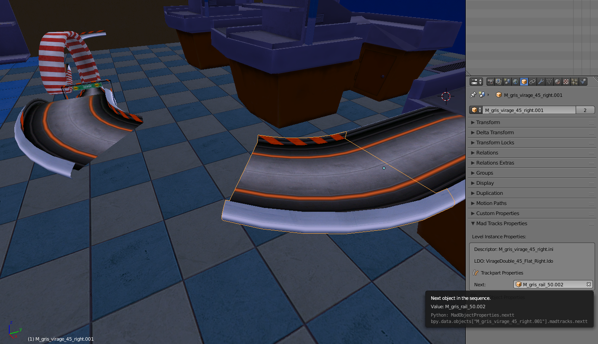
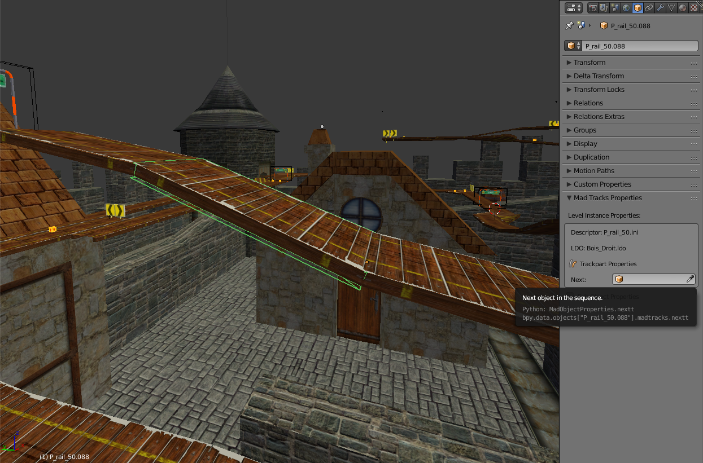
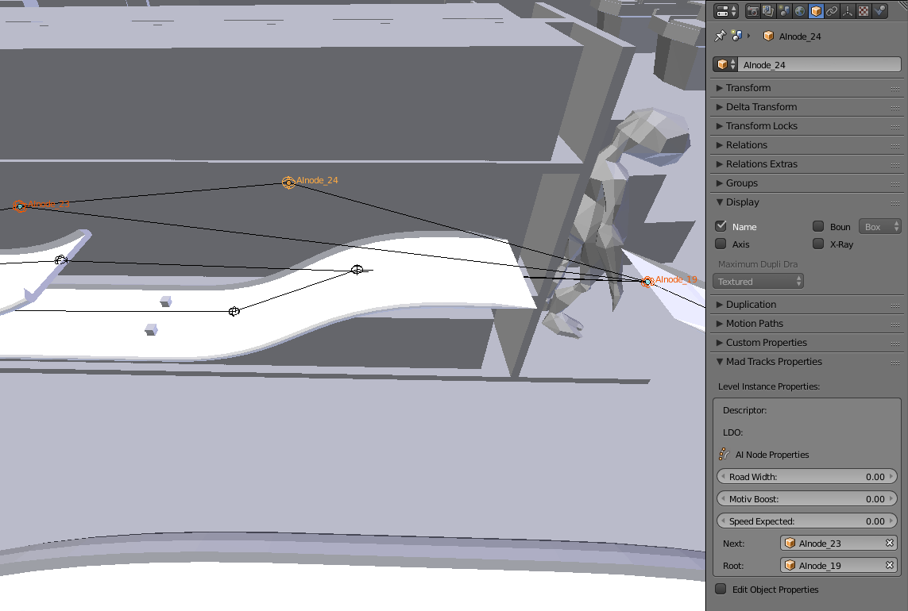
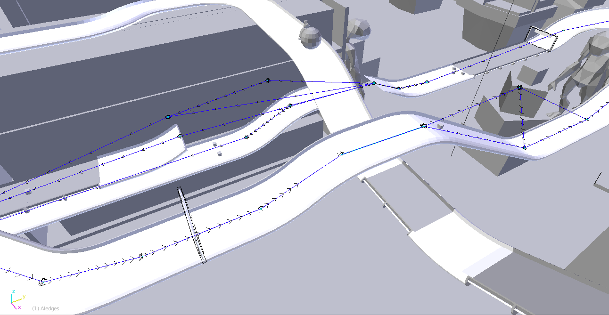
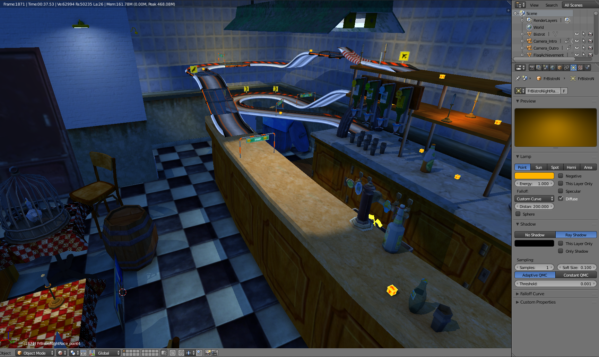

## Blender controls

Quick list of the most used key combinations when using the add-on, for those unfamiliar with Blender (there will still be a big learning curve though):
 
Move object: ***G + X/Y/Z (+ X/Y/Z for local axis)***, you can enter a distance with the numpad or use the mouse  
Rotate object: ***R + X/Y/Z (+ X/Y/Z for local axis)***, you can enter an angle with the numpad or use the mouse  
Duplicate object: ***Alt+D***  
Reset view on selected object(s): ***Numpad .***  
Snap 3D cursor to selected object and vice-versa: ***Shift+S***  

All of these controls should be used in Object mode. Moving or rotating a mesh in Edit mode won't be picked up by the level exporter.

## Main panel

The main panel is accessible on the left of the 3D view in Object mode (hidden in Edit mode). All add-on features are regrouped here.  

From top to bottom:  
**1. Import/Export subpanel** buttons will open the file browser to import/export assets from/to the extracted data.zip file. The extracted gama data folder path pasted in this subpanel is needed to automatically import other necessary files from the folder (like texture files if a model is imported).  
**2. Trackparts subpanel** buttons will add/select/delete trackparts and help to organize level trackpart sequences in a way the game can understand.  
**3. AI Paths subpanel** buttons will add/link AI nodes and help to organize level AI paths in a way the game can understand.  
**4. Lightmap subpanel** buttons will destructively setup the scene for lightmap baking and allow to (re)generate a lightmap texture applied to the scene for preview.

### Importing game assets

When clicking on the "Import" button of the main panel, the file explorer opens to let you pick a file from the extracted game data folder (working outside of this folder is possible, but the operator will always look for other needed files in the game data folder).  
When a file is selected, the file type and import options are displayed at the bottom of the left side bar. INI files are used for many types of game files, so the INI type to import needs to be set correctly in the options depending on the file selected.

A list of supported files (some partially supported):  
**.ldo (...\Gfx\models\Geometry)** A static game 3D model with materials  
**.ini (...\Bin\Descriptors)** A game object descriptor, it can define a movable model, a light, a camera, pickup, game zone...  
**.ini (...\Bin\Levels)** A list of static model and game object instances with positions and rotations that make up a level  
**.dam (...\Bin\Levels)** Level settings for game rules, the world to use, intro/outro cameras and more  
**.gra (...\Bin\Levels)** A sequence of nodes and edges for AI navigation in a level  
**.ldl (...\Gfx\Lightmaps)** A sequence of static models with UV coordinates of a level lightmap

#### Tips

* Don't forget to choose the INI type in the import options, otherwise you will trigger a runtime error when importing a .ini file with the wrong type set.

* When importing a level, importing the .ini file will give you most of the level geometry, but it's sometimes necessary to also import the .dam file since the optional level skybox and world model are stored there. Some levels are located at the bottom of the skybox, far below the 3D view origin.

* The add-on has trouble importing multiple levels correctly in the same Blender session. It's better to open a new session instead of deleting the previous level from the scene.

## Making a level

The add-on can be used to import, edit or create a level from scratch. A lot of effort was put in simplifying and automating the level editing process, but you will still need time and motivation to make your first fully-playable level, especially if you are new to Blender.  
**Important tip**: save your project regularly as Blender can crash randomly when updating the add-on custom properties and links.  
**Important tip 2**: keep your mouse on any UI field or button to get tooltips. They are the most detailed and up to date add-on documentation.

#### Tips

* Importing an existing level .ini file is the recommended way to start making a level, but there will be lots of instances to delete, even with the "Import Raceline" option disabled. After importing, hitting *Space* and typing "Select Pattern" will allow to select all instances of an object you wish to delete by typing part of the object name between wildcard (\*) characters.

### 1) Placing level instances

Level instances in this context is every object which isn't a trackpart (start/finish, checkpoints, road pieces). Those are handled by the trackparts editor (see next chapter).

#### Tips

* When importing an instance to add to your level, make sure the the "As Level Instance" import option is checked.

* Instances are imported in the scene at the 3D cursor position. You can right click on a surface in the 3D view to set the cursor position before importing, or else press *Numpad .* after importing to focus on the asset and place it manually.

* When rotating an object in the level, hit the *X*, *Y* or *Z* key a second time to rotate on the local axis. This is sometimes much easier than rotating on the global axis.

* When moving an object in the level, hit the *X*, *Y* or *Z* key a second time to translate on the local axis. This is sometimes much easier when moving an object that was rotated.

* Blender gizmos are enabled by default and are fine for simple adjustments, but most of the time it will be quicker to disable them and use the magnet tool instead, which will snap the object to surfaces of other objects when moving it.

* Importing directionnal light descriptors will make the objects in the 3D view flicker, it will be fixed after rotating the light to the desired sun angle.

* When duplicating an object in the level, using *Alt+D* is better for convenience and performance since objects will share the mesh/material data (unlike *Shift+D*).

### 2) Creating trackpart sequences

Trackparts are level instances with a twist: they are linked together in sequences for the game to calculate their position/rotation, as some trackparts are marked as "inverted" to reuse models (a right turn is a left turn rotated 90°, a down slope is an up slope rotated 180° etc...).  
The trackparts editor (Trackparts subpanel of the Main panel) provides buttons to help maintain trackpart sequences and visualize how the game will load them.

When clicking on a + button, the default import position is the 3D cursor, or it will be appended to the selected trackpart in the 3D view if there is one.
Checkpoints can be appended to a trackpart, but they will never be part of a sequence.

The "Next" object field you see in the bottom right corner of the picture is set automatically when clicking on a + button with a trackpart selected in the 3D view. It sometimes needs to be updated manually to fix trackparts linking, like after replacing the deleted trackpart in the middle of this sequence. The "Select Linked" button in the editor will help you visualize the links since it follows the "Next" property until it is empty or invalid.  

Another case where manually editing the "Next" object field is necessary is to rotate trackparts of a sequence individually to make slopes. Clearing the "Next" field of all the slope trackparts will export their individual location/rotation instead of letting the game compute them, which would result in a flat road.

Finally, you need to define the checkpoint order. This is done by renaming the checkpoints in alphanumerical order. Make sure the "Use Checkpoint Names" INI export option is enabled when exporting the level instances.

#### Tips

* Importing stock levels will help you understand how trackparts were handled in the original game.

* You will know all trackparts links are correct when nothing moved after clicking the "Recalculate All" editor button, which will also clean up invalid links.

* Duplicating an entire sequence with *Alt+D* is possible. It can be used to stick two wooden roads side-by-side, or stitch two roads together by manually setting the "Next" object field from end of road 1 to beginning of road 2 and clicking "Recalculate All".

### 3) Creating AI paths

AI paths are made of nodes with a position and link(s) to the next node(s). They are used for AI navigation and to define the track boundaries.  
The AI paths editor (AI Paths subpanel of the Main panel) allows to place AI nodes using the 3D cursor position with automatic linking to the selected node.

Similarly to the trackparts editor, the AI paths editor uses the "Next" object field of each AI node for the forward links. But this is not enough for branching paths, since a node has multiple next nodes. For this, AI nodes also have a "Root" object field you need to set manually to point to the root node of the branching paths. All links to a root node will be converted to forward links when exporting the paths. This allows to create and edit complex branching paths rather quickly.  
AI nodes also have various properties to make the track boundary bigger or smaller, regulate the AI opponents speed and path-taking.

The editor also provides a button to draw the "Next" and "Root" links to visualize how the paths will be exported.  
AI opponents immediately respawn when they are too far from the path, meaning that jumps often have multiple paths to prevent AI cars from respawning mid-air.  

#### Tips

* Importing stock levels will help you understand how AI paths were handled in the original game. You will for example see that AI paths don't loop at the start even for lap races.

* Switching to Solid mode in the 3D view makes it much easier to see the AI nodes and links.

* After drawing the paths, hit *Tab* to switch to edit mode, this will highlight the paths and show the direction of the links.

* Level .dam files have a line called "RoadWidth", which is usually set between 25 and 28. This allows to set the base track boundaries. Edit the "Road Width" AI node object property to override the base width at that node, useful when the track surface is wider or smaller than trackparts.

* Don't worry about ".00x" suffixes to AI node names when adding or renaming them, this is accounted for by the exporter. It happens when a node with the same name was previously deleted from the scene.

### 4) Creating a lightmap

Disclaimer: this feature is experimental. If you can't or don't want to use a lightmap in your level, leaving the original lightmap as-is should make the game abort loading the lightmap and use its own lighting engine instead, which provides okay lighting without shadows.  

A lightmap is a texture containing the world lighting that is applied to the level instances in-game, for detailed lighting effects at low cost.  
In a level editing context, the world lighting comes from the level's light instances, meaning all original lightmaps can be recreated after importing the level. You still need to enable ray shadows for lights that should cast shadows in the lightmap, and set the shading type of specific objects from "Flat" to "Smooth" depending on what looks best to you.  
Taking the "Black out" level after a few of these tweaks as an example:

On the right side of the picture you can see "Ray Shadow" has been enabled for the orange light at the back of the room. After importing a level, all lights that don't cast car shadows will have "No Shadow" enabled. You are free to tweak the world lighting however you like before generating the lightmap, as it will only affect the resulting texture.

The lightmap baking algorithm follows the same object ordering than when exporting level instances, which is a game requirement. So make sure the level instances were exported properly before proceeding with the lightmap.

Once the world lighting setup is done, the lightmap editor (Lightmap subpanel of the Main panel) will generate the lightmap files at the click of a button, which will also destructively merge bakeable level instances, so **save your project beforehand**:

* A file named "LevelName.ldl" is written in *Gfx/Lightmaps* of the extracted game data folder.
* A "LevelName_lgt0000" image is created in Blender, which is then applied to a "Lightmesh" object for a preview of the lightmap.

Materials which emit light in-game like road trackparts won't emit light in the lightmap preview, as this is a post-processing effect not baked into the lightmap.  
You can click the bake button again after some lighting adjustments until the lightmap looks correct. Then switch the 3D view window to the UV/Image editor and save the lightmap texture as PNG ("Image > Save As Image"). You will need to use an external software to resize the .png texture to 1024*1024 with linear interpolation and export it as .dds (with GIMP the compression type should be set to "BC1/DXT1").

#### Tips and limitations

* Switching to Rendered mode in the 3D view makes it much easier to visualize the world lighting that will be baked to the lightmap texture (like in the picture above).

* The native Blender lightmap algorithm has a limitation where ~10% of the faces (the smallest ones) are missed, resulting in artifacts which need to be fixed by editing the lightmap texture by hand. Some stock models share vertices between faces based on their UV coordinates, which isn't supported by Blender's native unwrap algorithm, meaning these faces lighting can be distorted and spread across the entire lightmap texture. This breaks lightmaps for the levels that use these models and it is impossible to fix by hand.

* The shaders settings chosen by the add-on don't perfectly emulate the game's shaders.
