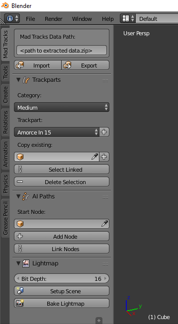
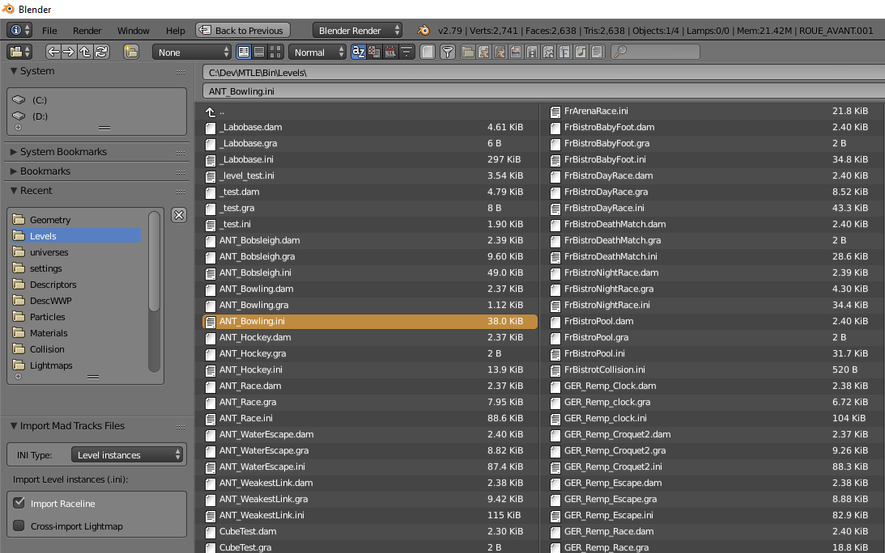

## Main panel

The main panel is accessible on the left of the 3D view in Object mode (hidden in Edit mode). All add-on features are regrouped here.  
**Important tip**: keep your mouse on any UI field or button to get tooltips. They are the most detailed and up to date add-on documentation.

From top to bottom:  
**1. Import/Export subpanel** Operator buttons will open the file browser to import/export assets from/to the extracted data.zip file. The extracted gama data folder path pasted in this subpanel is needed to automatically import other necessary files from this directory (like texture files if a model is imported).  
**2. Trackparts subpanel** Operator buttons will add/select/delete trackparts and help to organize level trackpart sequences in a way the game engine can understand.  
**3. AI Paths subpanel** Operator buttons will add/link AI nodes and help to organize level AI paths in a way the game engine can understand.  
**4. Lightmap subpanel** Operator buttons will destructively setup the scene for lightmap baking and allow to (re)generate a lightmap image applied to the scene for preview.

## Importing game assets

When clicking on the "Import" button of the main panel, the file explorer opens to let you pick a file from the extracted game data folder (working outside of this folder is possible, but the operator will always look for other needed files in the game data folder).  
When a file is selected, the file type and import options are displayed at the bottom of the left side bar. INI files are used for many types of game files, so the INI type to import needs to be set correctly in the options depending on the file selected.

A list of supported files (some partially supported):  
**.ldo (...\Gfx\models\Geometry)** A static game 3D model with materials  
**.ini (...\Bin\Descriptors)** A game object descriptor, it can define a movable model, a light, a camera, pickup, game zone...  
**.ini (...\Bin\Levels)** A list of static model and game object instances with positions and rotations that make up a level  
**.dam (...\Bin\Levels)** Level settings for game rules, the world to use, intro/outro cameras and much more  
**.gra (...\Bin\Levels)** A sequence of nodes and edges for AI navigation in a level  
**.ldl (...\Gfx\Lightmaps)** A sequence of static models with UV coordinates of a level lightmap

### Tips

* Singular objects are imported in the scene at the 3D cursor position. You can right click on a surface in the 3D view to set the cursor position before importing. Otherwise you can press *Numpad .* after importing to focus on the asset and place it manually.

* When importing a level, importing the .ini file will give you most of the level geometry, but it's sometimes necessary to also import the .dam file since the optional level skybox and world model are stored there.

* The add-on has trouble importing multiple levels correctly in the same Blender session. It's better to open a new session instead of deleting the previous level from the scene
